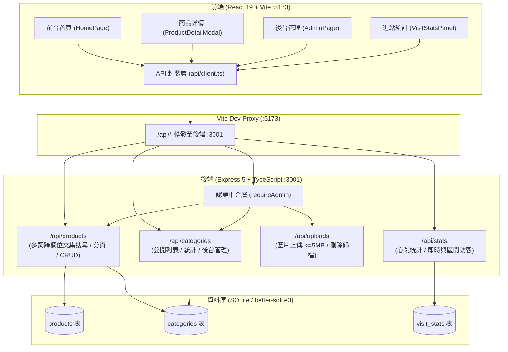
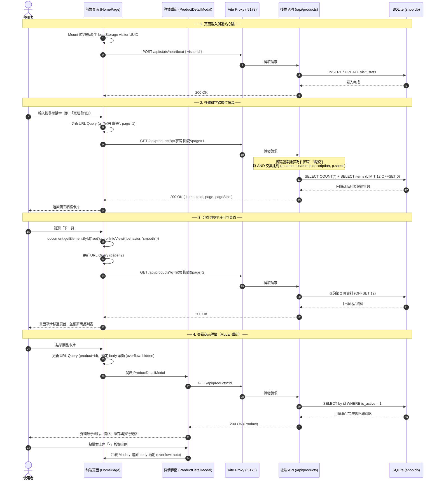
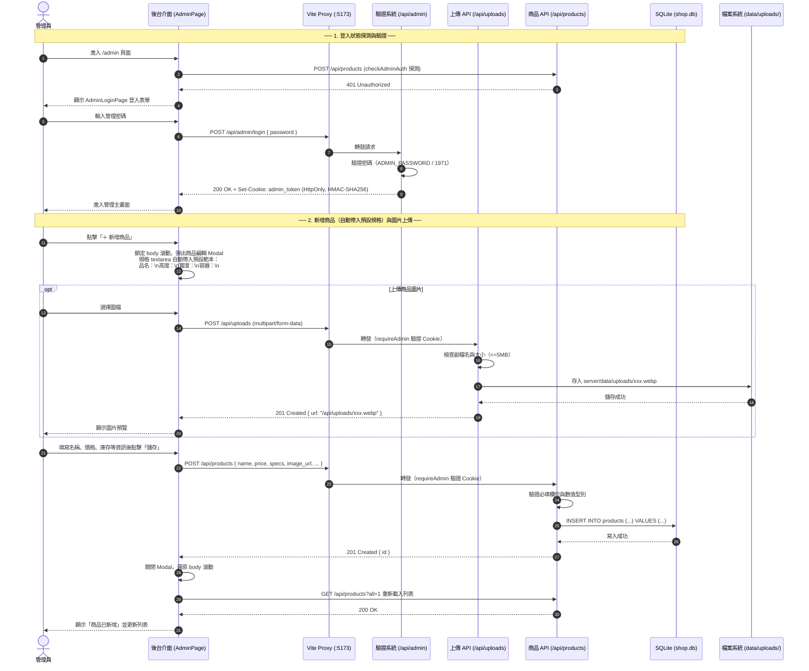

# 前後端互動流程

依本專案實際架構繪製：React SPA（5173）→ Vite proxy（`/api`）→ Express API（3001）→ better-sqlite3 → `server/data/shop.db`。

## 1. 系統整體架構與資料流向

---

## 2. 前台：多關鍵字搜尋、分頁切換與詳情 Modal 互動流程

---

## 3. 後台：登入驗證、商品管理（預設範本）與圖片上傳

---

## 4. 架構核心設計要點

1. **前後端分離與 Proxy**：
   - 前端 React SPA 透過 Vite Proxy（`/api`）轉發請求至 Express 後端，開發與生產環境均保持一致路徑。
2. **多關鍵字跨欄位搜尋（Multi-term Tokenized AND Search）**：
   - 將搜尋字串依空格切分，每個單字獨立比對 `(p.name LIKE @q_i OR c.name LIKE @q_i OR p.description LIKE @q_i OR p.specs LIKE @q_i)`，並以 `AND` 交集比對，支援任意順序與跨欄位組合。
3. **安全認證**：
   - 自製 HMAC-SHA256 Token 存於 `HttpOnly` + `SameSite=Lax` Cookie（`admin_token`），所有修改與上傳操作皆經 `requireAdmin` 驗證。
4. **SQL 防護**：
   - 所有 SQL 查詢均採用具名參數（Named Parameters `@param`），排序使用白名單映射（`SORTS`），防止 SQL Injection。
5. **使用者互動體驗**：
   - **Modal 背景鎖定**：彈窗開啟時自動將 `body` 設為 `overflow: hidden`，遮罩設定 `overscroll-behavior: contain` 防止背景滾動穿透。
   - **分頁平滑滾動**：切換分頁時自動透過 `document.getElementById('root').scrollIntoView({ behavior: 'smooth' })` 平滑回到頁面頂部。
