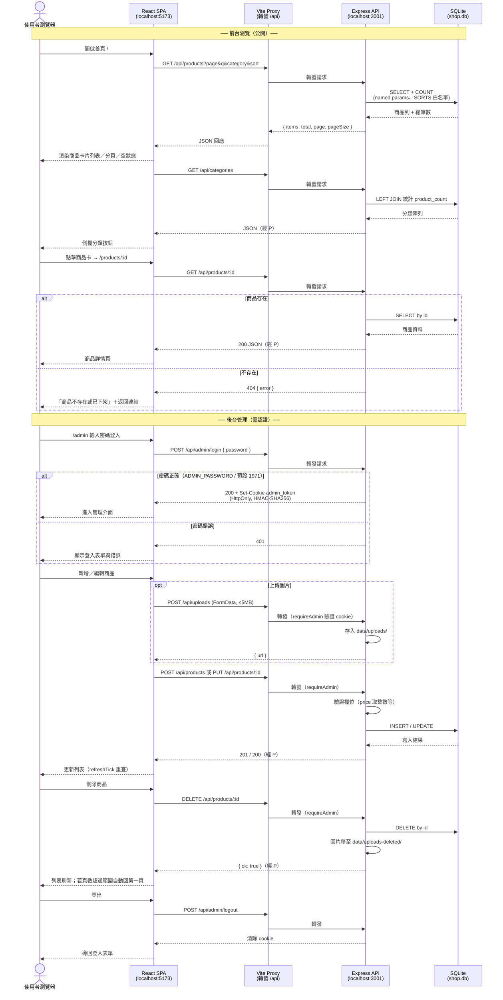

# 前後端互動流程

依本專案實際架構繪製：React SPA（5173）→ Vite proxy（`/api`）→ Express API（3001）→ better-sqlite3 → `server/data/shop.db`。



## 要點

- 前後端分離：SPA 只透過 `/api` 溝通，dev 由 Vite proxy 轉發，避免 CORS
- 認證：自製 HMAC-SHA256 token 存 HttpOnly cookie（`admin_token`），寫入操作都過 `requireAdmin`
- SQL 安全：WHERE 用 named parameters、排序取自 `SORTS` 白名單，不可拼接使用者輸入
- 圖片檔案：上傳存 `server/data/uploads/`，刪除商品時移至 `data/uploads-deleted/`

---

## 進站統計流程（2026-08）

補充 stats 路由與後台面板的互動細節。

```mermaid
sequenceDiagram
    participant B as Browser (React)
    participant V as Vite Proxy (5173)
    participant A as Express API (3001)
    participant D as SQLite DB
    participant F as File System

    rect rgb(245, 245, 255)
        Note over B, F: 1. 前台商品瀏覽（heartbeat、分類篩選、搜尋、翻頁）

        B->>B: Mount 時讀取/生成 localStorage visitor UUID
        B->>V: POST /api/stats/heartbeat { visitorId }
        V->>A: 轉發請求
        A->>D: INSERT/UPDATE visit_stats (first_seen, last_seen)
        D-->>A: OK
        A-->>V: 200 OK
        V-->>B: 200 OK

        B->>V: GET /api/categories
        V->>A: 轉發請求
        A->>D: SELECT categories 包含 product_count
        D-->>A: 分類清單
        A-->>V: JSON
        V-->>B: JSON 渲染分類選單

        B->>B: 點擊操作，更新 URL Query (page, q, category, sort)
        B->>V: GET /api/products?page=1&q=...&category=...
        V->>A: 轉發請求
        A->>D: SELECT products（動態組裝 WHERE @q, @category 等）
        D-->>A: 商品列表資料
        A-->>V: JSON
        V-->>B: JSON 渲染商品列表
    end

    rect rgb(255, 245, 245)
        Note over B, F: 2. 後台登入 + 商品 CRUD（認證 cookie 流程）

        B->>V: POST /api/products（checkAdminAuth 探測登入狀態）
        V->>A: 轉發請求
        A-->>V: 401 Unauthorized（無 Token）
        V-->>B: 401 引導顯示登入表單

        B->>V: POST /api/admin/login { password }
        V->>A: 轉發請求
        A->>A: 驗證密碼，簽發 HMAC-SHA256 Token
        A-->>V: 200 OK + Set-Cookie: admin_token=...; HttpOnly; SameSite=Lax
        V-->>B: 200 OK（瀏覽器自動儲存 Cookie）

        B->>V: GET /api/products?all=1（帶 Cookie，含下架商品）
        V->>A: 轉發請求（含 Cookie）
        A->>A: requireAdmin 驗證 Token（通過）
        A->>D: SELECT products (all=1)
        D-->>A: 商品列表資料
        A-->>V: JSON
        V-->>B: JSON 渲染後台商品表

        B->>V: POST /api/products（帶 Cookie，新增商品）
        V->>A: 轉發請求（含 Cookie）
        A->>A: 驗證 Token（通過）
        A->>D: INSERT INTO products
        D-->>A: OK
        A-->>V: 200 OK { id }
        V-->>B: 200 OK
    end

    rect rgb(245, 255, 245)
        Note over B, F: 3. 圖片上傳

        B->>V: POST /api/uploads（multipart/form-data, max 5MB）
        V->>A: 轉發請求（含 Cookie）
        A->>A: 驗證 Token（通過）
        A->>F: 寫入檔案至 data/uploads/
        F-->>A: 寫入成功
        A-->>V: 200 OK { url: "/api/uploads/..." }
        V-->>B: 200 OK { url } 回填表單 image_url
    end

    rect rgb(255, 250, 240)
        Note over B, F: 4. 後台進站統計查詢

        B->>V: GET /api/stats/visits（每分鐘 poll）
        V->>A: 轉發請求
        A->>D: COUNT(*) WHERE last_seen_at 大於各時間點
        D-->>A: 各區間統計數據
        A-->>V: JSON { online, today, week, month, total }
        V-->>B: JSON 渲染 VisitStatsPanel 面板
    end
```
